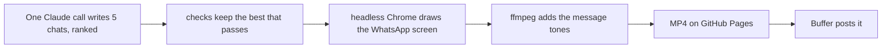

# Mummy is typing…

Funny, too-real WhatsApp chats between an Indian Mummy and her daughter, two a day (13:00 and 21:00 India time), rendered as reels and
posted automatically to Instagram (and YouTube or Facebook if you add them in Buffer). Same pipeline as Untold Files,
minus the voice.



## Where things live

- `brand/brand.json`: name, handle, hashtag, post times.
- `brand/cast.json`: Mummy, and how she texts. Every chat is Mummy and her daughter, nobody else.
- `brand/series.json`: the recurring formats and how often each runs (`weight`).
- `prompts/writer.md`: the rules Claude writes by, above all the anti-cringe and emoji rules.
- `scripts/write.ts`: the Claude call and the checks (message count, emoji, banned tropes, length, repeats).
- `engine/index.html` + `engine/timeline.js`: the WhatsApp screen and its timing.
- `brand/art/` + `brand/art.json`: the cover illustrations and each one's colours, text position and fade. Each reel
  uses the picture that has gone longest unused. Only use art you made or have the rights to.
- `engine/sounds/`: lookalike tones made by `npm run sounds`. Put your own `send.mp3` and `receive.mp3` in
  `brand/sounds/` to use those instead.

## Locally

```bash
npm ci
npm run preview -- engine/sample.json      # watch a chat live in your browser, with sound
npm run write                              # Claude writes the next slot's chat into reels/
npm run make -- reels/<id>.json            # render it to out/<id>.mp4 (+ a contact sheet)
npm run daily -- --test                    # write and render the next slot
```

Edit a chat by hand? `npm run check -- reels/<id>.json` runs the same checks.

## Going live

1. Create the GitHub repo and push.
2. Secrets: `CLAUDE_CODE_OAUTH_TOKEN` (from `claude setup-token`) and `BUFFER_API_KEY_1`.
3. Settings → Pages → Source: **GitHub Actions**.
4. Connect the new Instagram account in Buffer, run `npm run post -- --channels`, and paste only this page's
   channels into `brand/channels.json`.
5. Test: `gh workflow run daily.yml -f test=true` and watch the video attached to the run.
6. `gh variable set DAILY --body on`, then after a week of checking each reel, `gh variable set POSTING --body on`.
